<p align="center">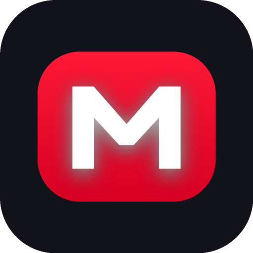</p>

<h1 align="center">MeuTube</h1>

<p align="center">
<a href="https://github.com/abulalimasrur5436/MeuTube/releases/latest"></a>
<a href="LICENSE"></a>
<a href="https://github.com/abulalimasrur5436/MeuTube/stargazers"></a>
</p>

**YouTube, reimagined. Different by design. Smooth by nature.** <br><br> **A YouTube video and music client, all in one app:** MeuTube for videos, and MeeTune, its music side, one tap away.<br><br> No ads. No interruptions. Just a gorgeous liquid glass interface, synced lyrics, background playback, and one-tap downloads.<br><br> **A fresh way to experience YouTube.**<br><br>

<p align="center">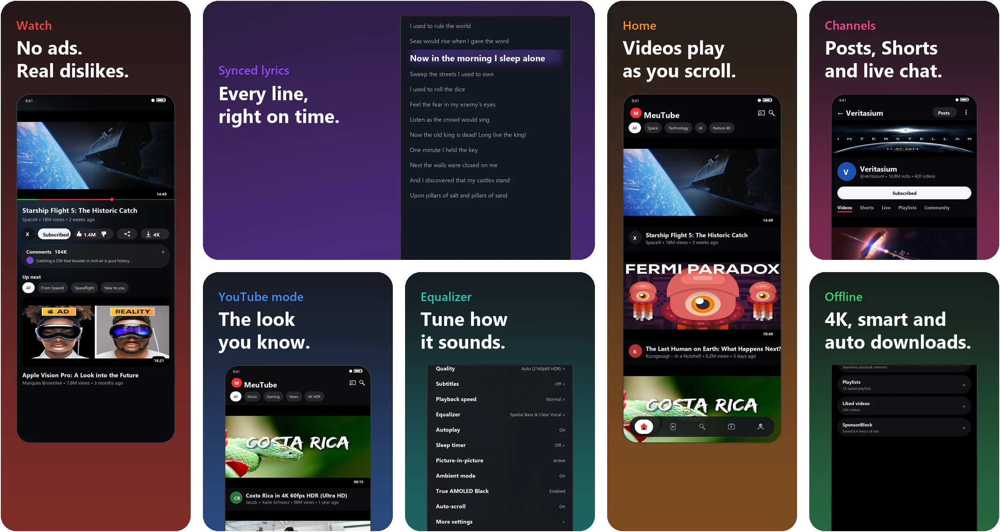</p>

<p align="center"><a href="https://github.com/abulalimasrur5436/MeuTube/releases/latest"><b>⬇ Download the latest MeuTube</b></a></p>

<p align="center"><a href="#MeuTube-tv"><b>📺 On a TV? Get MeuTube TV</b></a></p>

> [!IMPORTANT]
> MeuTube is not affiliated with, endorsed by, or connected to YouTube or Google in any way. Use it at your own discretion.

## Features

<table>
<tr>
<td width="25%">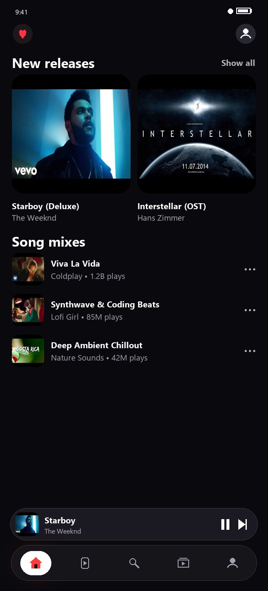</td>
<td width="25%">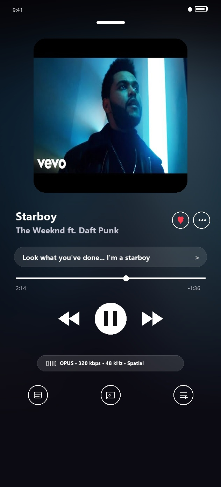</td>
<td width="50%">

### MeeTune, your music side (beta)
One app for YouTube videos **and** YouTube Music. Tap the logo on Home and MeuTube turns into a music app; tap it again to go back.

- **Your music:** YouTube Music's Home, Explore, Library and Search, with albums, artists, playlists, moods and your liked songs.
- **A real music player:** synced lyrics, a moving cover, the song's format on a glass pill, and a radio that keeps the songs coming.
- **Sound that surrounds you:** Spatial sound with a real head model (MIT KEMAR) and a Cinema level with deeper bass, Head tracking on Android 13+ through your phone's own spatial audio, Dolby, headphone correction, and crossfade between songs.
- **Quality your way:** pick the audio quality for Wi-Fi and for mobile data, and a speed for your songs (0.25x to 4x, in 0.01 steps) that a video's speed never changes.
- **Plays anywhere:** downloads with lyrics play offline, and cached songs play with no network at all.
- **Its own space:** a History, Downloads and an equalizer just for your songs, and a player kept apart from your videos.

MeeTune is in beta and growing with every release.

</td>
</tr>
<tr>
<td width="25%">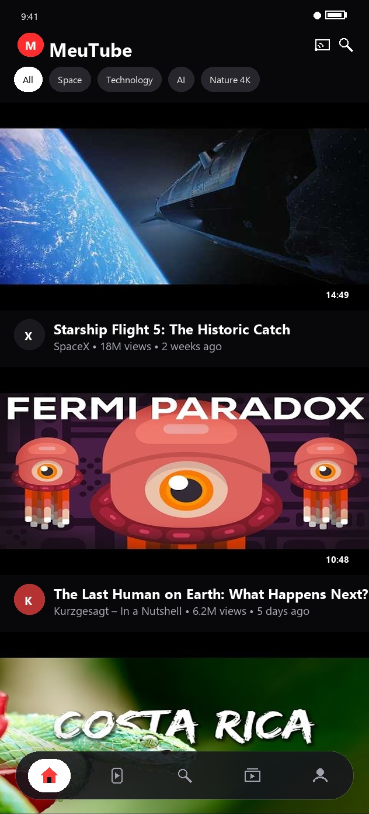</td>
<td width="25%">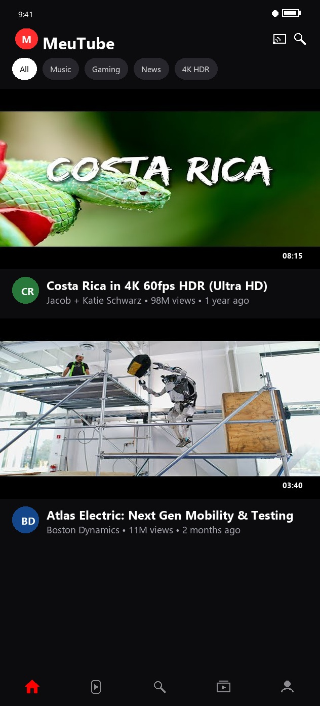</td>
<td width="50%">

### Liquid glass, or YouTube mode
Frosted glass on the tab bar, the player and Shorts, lit by a glow that follows your tab. Videos on Home start playing as you scroll. Prefer the familiar look? **YouTube mode** docks a flat bar at the bottom and puts Search up top.

</td>
</tr>
<tr>
<td width="25%">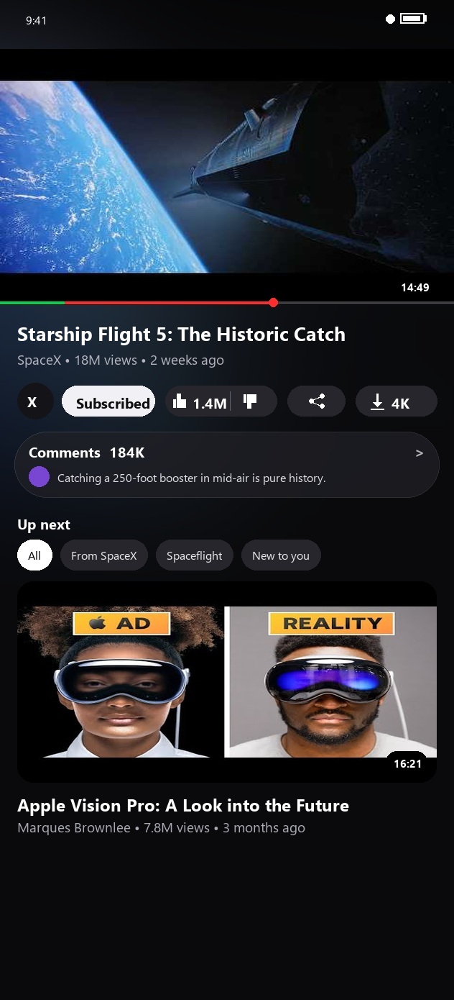</td>
<td width="25%">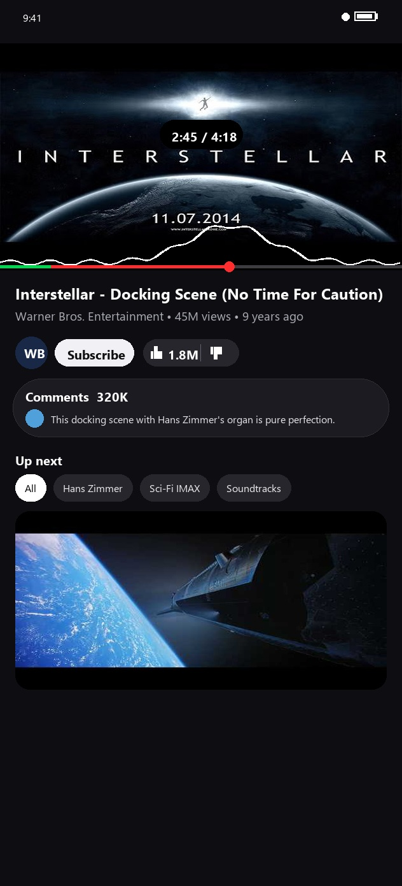</td>
<td width="50%">

### A player that shows more
The compact watch page puts the actions beside Subscribe and the top comments right under the video. A **Most replayed** graph rises over the seek bar, and seeking shows the real frame.

</td>
</tr>
<tr>
<td width="25%">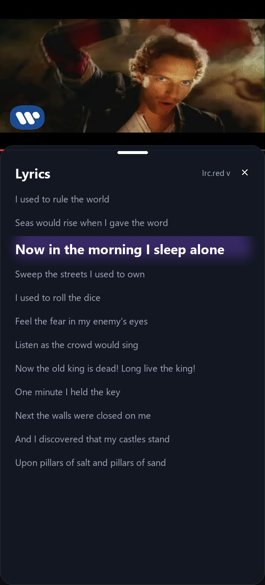</td>
<td width="25%">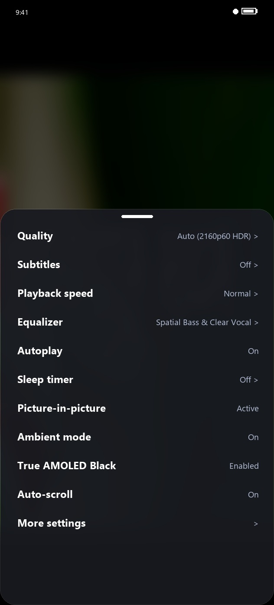</td>
<td width="50%">

### Synced lyrics and an equalizer
Music videos get live, line-by-line lyrics from the provider you pick. The **equalizer** sits in the player menu, with presets or your own bands applied live, original audio and volume up to 200%.

</td>
</tr>
<tr>
<td width="25%">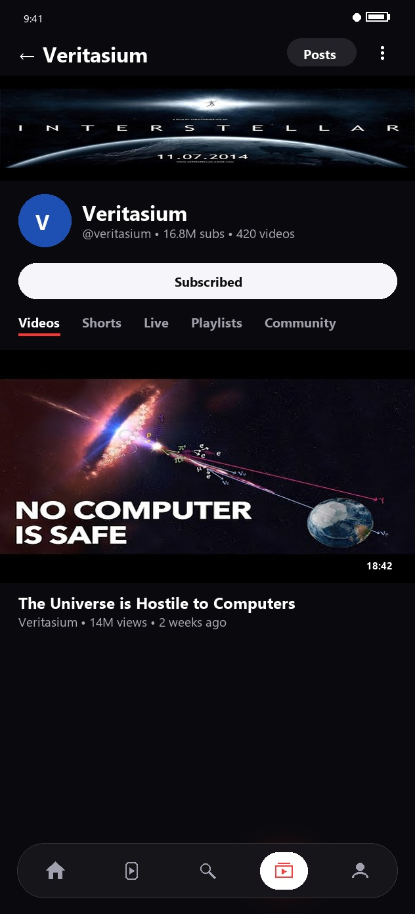</td>
<td width="25%">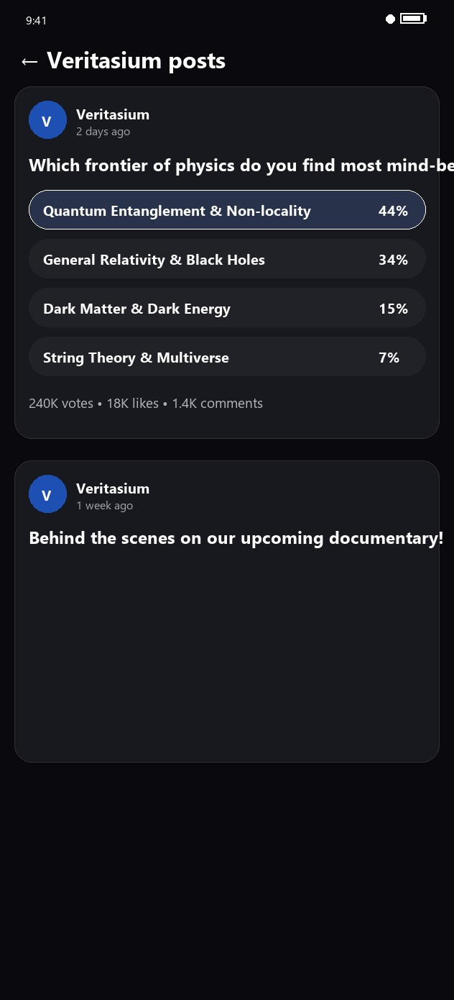</td>
<td width="50%">

### Channels, posts and live chat
Channel pages with the banner, Subscribe and every tab. Like and reply to **community posts**. On a live stream, **live chat** sits under the video, or beside it in fullscreen, and you can chat as any of your accounts.

</td>
</tr>
<tr>
<td width="25%">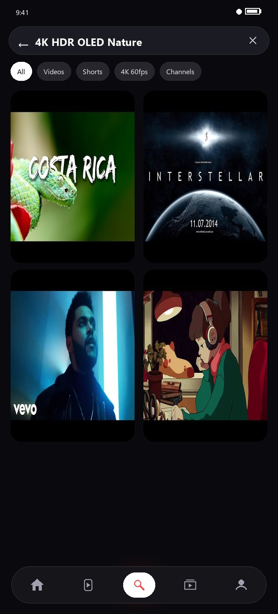</td>
<td width="25%">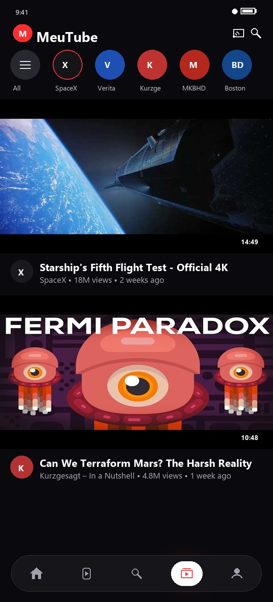</td>
<td width="50%">

### Search and Subscriptions
YouTube's one-tap chips for Videos, Shorts, Live and Recently uploaded, plus the full filter dialog. Your channels in a row on top of Subscriptions.

</td>
</tr>
<tr>
<td width="25%">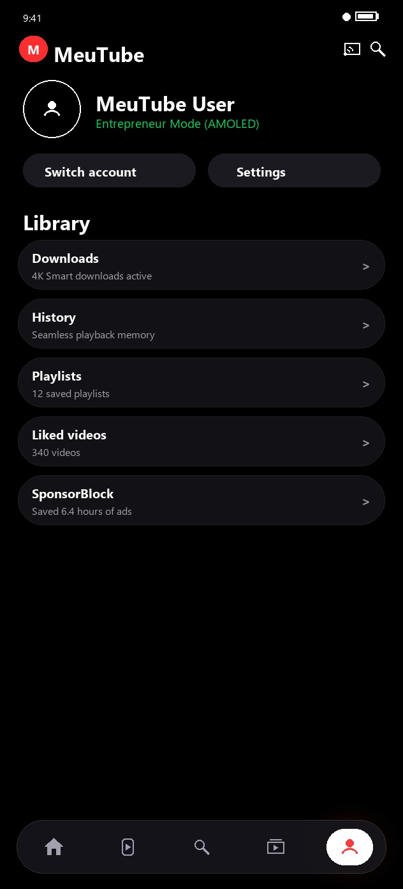</td>
<td colspan="2">

### Downloads in 4K, smart and automatic
Save videos up to **4K** in any folder you pick. **Smart downloads** remember your quality, so one tap saves. Turn on **auto download** and new uploads from the channels and playlists you choose download on their own.

</td>
</tr>
</table>

### And some more features I didn't forget (forgot many features to list :))

| | |
|---|---|
| 🚫 **No ads, no sponsors** | Ads are gone, and SponsorBlock skips sponsors, intros and "like and subscribe" reminders. |
| 👎 **Dislikes are back** | Return YouTube Dislike shows the real count, and DeArrow swaps clickbait titles and thumbnails. |
| 🎧 **Background play** | Lock the screen or switch apps and it keeps playing, with picture-in-picture for videos and Shorts. |
| 📱 **Shorts done right** | A clean full-screen player with glass like, comment and share buttons. |
| 🎨 **Make it yours** | Theme, light or dark, app icon, glass, Home layout, tabs and the video menu, all on one page. |
| 🌏 **Speaks your language** | English, Español, Polski, Português (Brasil), Română, Русский, 简体中文, 繁體中文 and العربية. [Help translate](TRANSLATING.md). |
| 🔐 **Your account** | Sign in with a code, or use it without an account. Cast to your TV. |

## Download

Get the APK for your phone from [Releases](https://github.com/abulalimasrur5436/MeuTube/releases/latest):

| Your device | File |
|:--|:--|
| Most phones (64-bit) | `MeuTube_<version>_arm64-v8a.apk` |
| Older phones (32-bit) | `MeuTube_<version>_armeabi-v7a.apk` |
| Not sure | `MeuTube_<version>_universal.apk` |

Android 7.0 or later.

Every release is built and signed in public by [GitHub Actions](https://github.com/abulalimasrur5436/MeuTube/actions/workflows/release.yml) from this repository's source, so you can see exactly how each APK was made.

## MeuTube TV

MeuTube's glass design on Android TV and Google TV, tuned its own way. It installs as its own app and updates itself.

- **Glass Home.** A frosted sidebar with a focus pill that glides between MeuTube's icons.
- **Glass player.** One frosted panel at the bottom: a seek bar with a glowing knob, and every button in a single row.
- **Search that glows.** The screen's edges light up when Search opens, and your words glow as you type.

<p align="center">
<a href="https://github.com/abulalimasrur5436/MeuTube"></a>
<a href="https://github.com/abulalimasrur5436/MeuTube"></a>
<a href="https://github.com/abulalimasrur5436/MeuTube"></a>
<a href="https://github.com/abulalimasrur5436/MeuTube"></a>
</p>

<p align="center"><a href="https://github.com/abulalimasrur5436/MeuTube-tv"><b>📺 Get MeuTube TV for your Android TV</b></a></p>

Downloads, the changelog and the code all live in [MeuTube-tv](https://github.com/abulalimasrur5436/MeuTube-tv). Get the newest APK from its [latest release](https://github.com/abulalimasrur5436/MeuTube-tv/releases/latest), and report TV bugs in its [issues](https://github.com/abulalimasrur5436/MeuTube-tv/issues).

## Build

```
./gradlew :mobile:assembleStmobileDebug     # debug, for testing
./gradlew :mobile:assembleStmobileRelease   # release, signed with keystore.properties if present
# APKs: mobile/build/outputs/renamed_apks/stmobile<Type>/MeuTube_<version>_<abi>.apk
```

Releases are made by pushing a `vX.Y.Z` tag: [release.yml](.github/workflows/release.yml) builds the signed APKs and publishes the GitHub release with its changelog. The glass is `mobile/src/stmobile/java/com/newtube/mobile/ui/common/GlassView.java`; the README showcase comes from `python tools/render_showcase.py`. Clone with `--recurse-submodules`. The backend lives in the `MediaServiceCore` and `SharedModules` submodules (MeuTube's own forks). Add `-PemulatorAbi` to run on an x86_64 emulator. Developer notes are in [CLAUDE.md](CLAUDE.md).

## Support MeuTube

MeuTube is designed to offer the cleanest, fastest, and most modern ad-free YouTube and YouTube Music streaming experience.

❤️ If you find MeuTube useful and want to support the project:
- ⭐ **Star this repository on GitHub** to help more people discover MeuTube!
- 📢 **Share MeuTube** with your friends and family.
- 💡 **Report issues or suggest ideas** in [Issues](https://github.com/abulalimasrur5436/MeuTube/issues).

Thank you for being part of the journey!

## Credits

Big thanks to the open-source projects that made MeuTube possible:
- [SmartTube](https://github.com/yuliskov/SmartTube) by [@yuliskov](https://github.com/yuliskov) for the media service architecture and ad-free playback core.
- [NewTube](https://github.com/aleixrodriala/newtube) by [@aleixrodriala](https://github.com/aleixrodriala) for the liquid glass UI and Android mobile design.
- [AutoEq](https://github.com/jaakkopasanen/AutoEq) by [@jaakkopasanen](https://github.com/jaakkopasanen) for headphone correction profiles.

## License

MIT, see [LICENSE](LICENSE). The original NewTube and SmartTube copyright notices are preserved. See [THIRD_PARTY_NOTICES.md](THIRD_PARTY_NOTICES.md).

